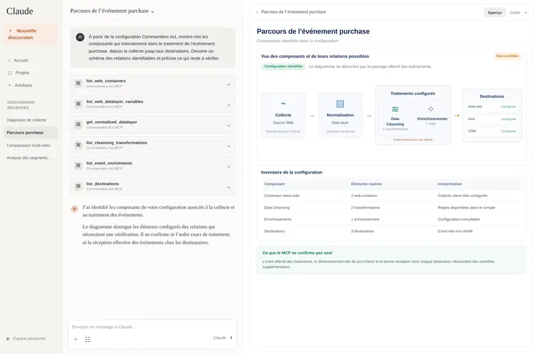

# Commanders Act MCP (closed beta)

## Explore your Commanders Act configuration with AI

Connect **ChatGPT or Claude** to Commanders Act and ask questions about your real configuration in plain language. Understand where data comes from, how tags and destinations are configured, and what monitoring information is available — without switching between multiple interfaces.

**Read-only by design:** The MCP lets your AI assistant retrieve and analyze available information. It cannot change or deploy your Commanders Act configuration.

## Start in three steps

1. [**Connect ChatGPT or Claude**](getting-started-closed-beta.md) — Add the Commanders Act MCP endpoint to your AI assistant and sign in with your existing Commanders Act account.
2. **Ask your first question** — `List the Commanders Act sites available to my account.`
3. [**Explore real-world prompts**](use-cases-and-prompt-library.md) — Trace event flows, compare websites, investigate tracking and review privacy data.

**To obtain the MCP server URL and access instructions, contact Commanders Act Support or your account manager.** Access is currently available to selected organizations during our controlled rollout. If your team has been invited but cannot connect, contact your Commanders Act account or support team.

## See what you can do

### Visualize a purchase event from collection to destinations

Ask the assistant to explain the expected flow of a purchase event through the parts of your Commanders Act configuration it can inspect. It can turn these relationships into an easy-to-read diagram and identify steps that still need verification.

[Try the purchase-event prompt](use-cases-and-prompt-library.md#visualize-the-journey-of-a-purchase-event)

### Other useful investigations

* **Investigate a conversion drop:** review relevant collection alerts, data quality and configuration history.
* **Compare multiple websites or markets:** see differences between web tags, server-side settings and marketing destinations.
* **Explore CDP audiences:** organize available segments into likely marketing use cases.
* **Review privacy data:** use cookie scanner results and consent statistics to prepare a prioritized investigation.

Each example includes a **ready-to-copy prompt**, and several show an actual example result: [Explore the prompt library](use-cases-and-prompt-library.md).

## What does it cover?

The MCP provides read access to available information across **Tag Management, Server-side, Sources & Destinations, Data & Audiences, Privacy, Monitoring, Reporting and Administration**.

It works with the user permissions of your Commanders Act account and supports existing **SSO and two-factor authentication (2FA)**.

For the complete list of supported areas, important limitations, data-handling guidance and frequently asked questions, see [Capabilities, Security & FAQ](capabilities-security-and-faq.md).

## What the MCP does — and does not — verify

The assistant can analyze accessible configuration and monitoring data, but a configured tag does not prove that an event was actually delivered. External advertising-platform results are not automatically available. Ask the assistant to distinguish **verified configuration, possible explanations and missing evidence**.

**Ready to try it?** [Get started](getting-started-closed-beta.md) · [Browse prompts](use-cases-and-prompt-library.md)
