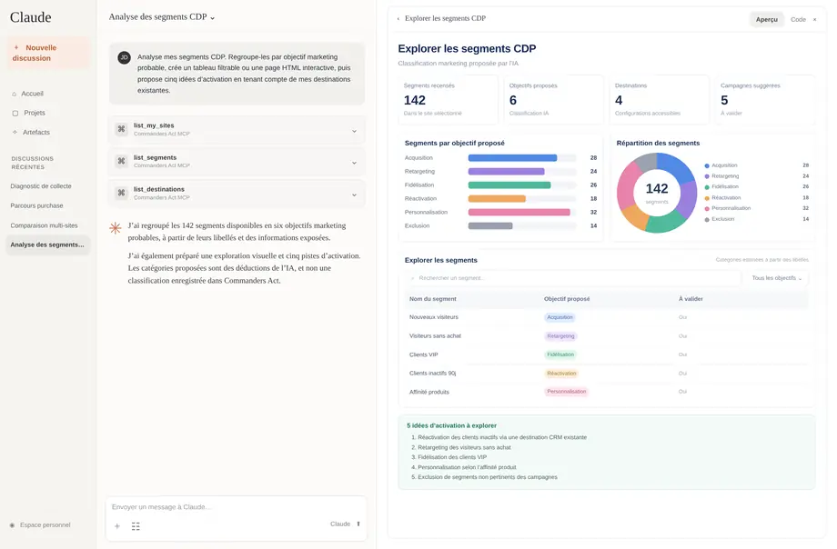
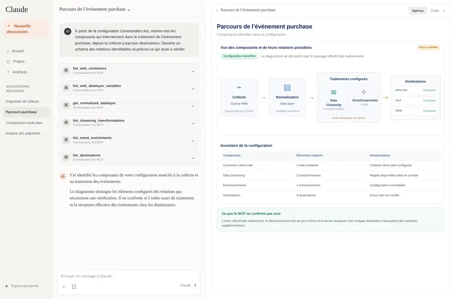
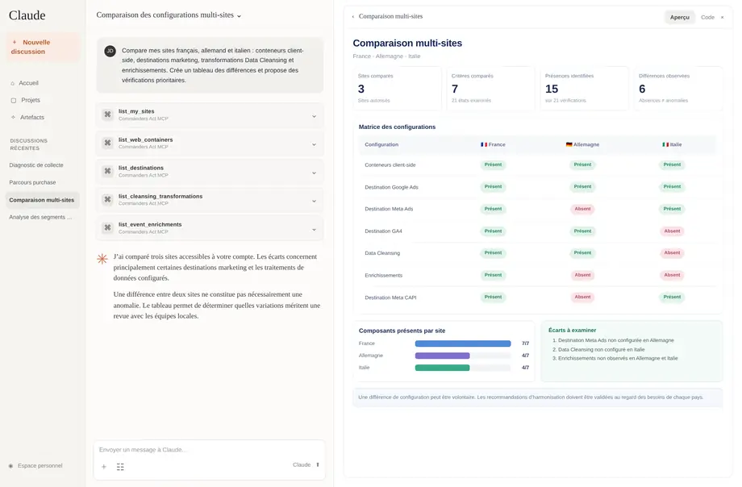

# Use Cases & Prompt Library

Get more than a list of configuration objects. These prompts help you investigate, compare and explain what is set up in your Commanders Act account.

**Before you start:** [Connect your AI assistant](getting-started-closed-beta.md) and ask it to list your accessible Commanders Act sites. Replace site names and other placeholders in the examples with your own.

**How to use this library:** Copy a prompt into ChatGPT or Claude, specify the site when needed, then ask follow-up questions. Responses depend on the data exposed to your account; AI-generated interpretations should be verified before you act on them.

***

## Practical examples

Once connected, you can ask Claude or ChatGPT questions about your actual Commanders Act environment, not just request technical lists. Replace \[site], country names, platforms and time ranges with your own. **Results depend on the account permissions and data exposed through the MCP tools.** Ask the assistant to distinguish verifiable findings from hypotheses.

### Understand the marketing use cases in your account

**Try this prompt:**

> Analyze my Commanders Act configuration and identify the marketing use cases that appear to be implemented, such as server-side conversion tracking, audience activation, data enrichment and consent management. Explain the business value, data used and connected platforms for each. Present the result as a non-technical use-case catalog and distinguish verified configuration from assumptions.

**What you can get:** A business-friendly overview of how your account is configured and which marketing activities it supports.

### Investigate a sudden drop in conversions

**Try this prompt:**

> Conversions reported in Meta Ads have dropped since yesterday. For \[site], examine Commanders Act collection alerts, available event monitoring, source data quality and recent configuration activity. Build a timeline of relevant observations, list possible tracking-related explanations, and prioritize what I should check next. Separate evidence from hypotheses and state what you cannot verify without access to Meta Ads.

**What you can get:** An evidence-based troubleshooting checklist and investigation timeline, without claiming to know the cause of external advertising results.

### Discover opportunities in your CDP audiences

**Try this prompt:**

> Analyze my Commanders Act CDP segments. Group them by likely marketing objective: acquisition, retargeting, retention, reactivation, personalization or exclusion. Build a searchable, filterable table or interactive HTML page. Propose five relevant activation ideas using my existing destinations, and mark classifications inferred from segment names.

**What you can get:** An organized, explorable segment catalog and new campaign ideas based on your current setup.

### Visualize the journey of a purchase event

**Try this prompt:**

> For \[site], reconstruct how the purchase event is expected to move from collection through relevant variables, transformations, web or server-side tags and marketing destinations in Commanders Act. Draw a flow diagram. Clearly mark verified configuration relationships, inferred steps and anything the available MCP data cannot confirm.

**What you can get:** A readable diagram of the event relationships visible in your configuration, useful for tracking documentation and investigations.

### Compare tracking across countries or brands

**Try this prompt:**

> Compare the Commanders Act setups of my French, German and Italian sites. Which advertising destinations, web containers, server-side configurations and relevant tags are present on some sites but not others? Generate a site-by-site comparison matrix and highlight differences worth reviewing, without assuming each difference is an error.

**What you can get:** A comparative matrix that makes multi-site governance and harmonization easier.

### Prepare a cookie and privacy review

**Try this prompt:**

> Review the latest available cookie scanner results and privacy statistics for \[site]. Group detected cookies by vendor where possible, identify items requiring further investigation, and prepare a prioritized compliance review checklist. If possible, display the findings as a filterable dashboard. Do not claim a legal violation without sufficient supporting evidence.

**What you can get:** A prioritized review based on observable cookie and privacy information.

## From answers to charts and interactive HTML pages

Claude and ChatGPT can enrich their answers with **tables, charts, flow diagrams, custom dashboards and even interactive HTML pages**, depending on the AI client's features. The MCP provides the data; the AI client creates the visualizations.

**Follow-up prompt:**

> Turn the Commanders Act results from this conversation into an interactive HTML dashboard. Add a summary, relevant charts, a searchable table, filters and a detail panel. Use only retrieved data, and label assumptions or missing values clearly.

You can refine the result in the same conversation: "Focus on reactivation audiences", "Add a chart by marketing objective" or "Summarize these insights for my team".

**Current limitations:** The Commanders Act MCP is read-only. It can inspect available information, but it cannot publish tag changes, edit configurations or create campaigns. External platform performance metrics may not be available. Interactive HTML generation and export depend on the features supported by your chosen AI client.

***

## Additional ideas to try

These are extra examples; the original prompts and their accompanying screenshots above remain unchanged.

### Review recent tag changes

> For \[site], review available recent administrative activity and the current web tag configurations. Summarize which tags appear to have been added or changed, the likely marketing purpose of each, and anything that requires confirmation. Distinguish activity log evidence from assumptions based on the current configuration.

### Compare server-side destinations

> For \[site], list the configured server-side tags and marketing destinations. Group them by vendor or use case where the configuration allows it, and highlight any missing details I should verify before relying on this overview.

## Tips for better answers

* Ask the assistant to **name the site and time period** it analyzed.
* Request a clear distinction between **observed configuration, inference and unavailable evidence**.
* Ask for a table or a diagram when comparing multiple sites or following an event flow.
* Treat an AI-generated hypothesis as a starting point for investigation, not proof of live tracking behavior.

For detailed coverage and limitations, see [Capabilities, Security & FAQ](capabilities-security-and-faq.md).
