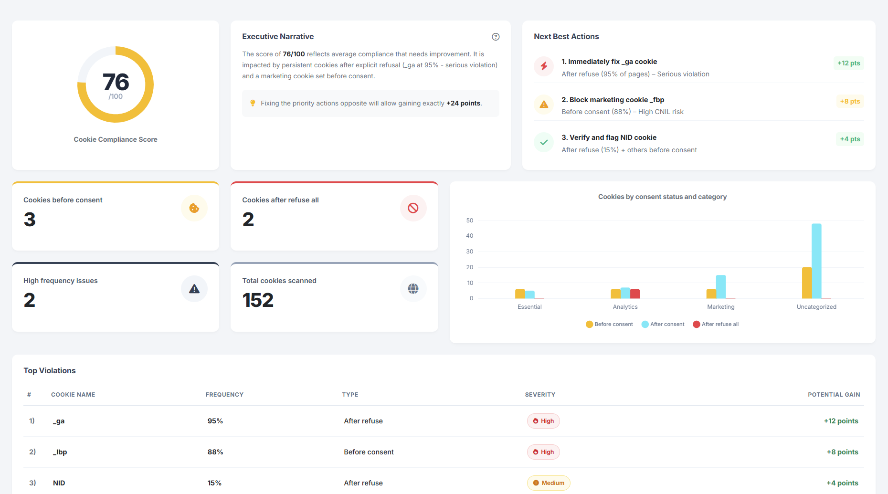
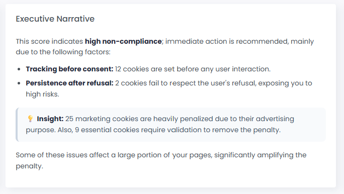

# Realtime Cookie Scanner

### 1. Introduction

The **Realtime Cookie Scanner (RCS)** is Commanders Act’s next-generation module for **continuous, intelligent, and real-world monitoring** of cookies and client-side storage (cookies, localStorage, sessionStorage, etc.).

Unlike crawler-based scanners that simulate visits with bots, the RCS observes **your real user sessions** — across all countries, devices, browsers, and contexts — and combines these observations with complementary detection technologies, providing a **complete, live picture** of what actually happens in your users’ browsers.

Whether a cookie appears only for **specific users, browsers, countries, forgotten landing pages, or A/B test variants**, RCS detects it.\
No missed edge cases, no blind spots, no delayed snapshots.

This approach also enables the detection of cookies that are not directly accessible through JavaScript, including third-party and HttpOnly cookies.

<figure><figcaption></figcaption></figure> <figure><figcaption></figcaption></figure>

***

### 2. Typical Use Cases

RCS provides Privacy, Marketing, and Technical teams with **instant, exhaustive, and actionable visibility** over every cookie and storage item.

**Common use cases include:**

* **Continuous CNIL / GDPR compliance monitoring**\
  Detect any cookie deposited before consent and stay compliant in real time.
* **Instant audit after container or tag deployment**\
  Ensure new releases haven’t introduced unauthorized cookies.
* **Proactive detection of new or undeclared partners**\
  Identify scripts depositing unexpected cookies.
* **Automatic multilingual cookie policy publication**\
  Generate and publish an auto-translated cookie table that stays up to date.
* **Post-release monitoring during redesigns or migrations**\
  Detect regressions or compliance issues immediately.

***

### 3. Key Features

#### 🔍 100 % Real-World Detection

* Observes real user sessions as they happen, complemented by additional browser and server-side detection technologies — going far beyond traditional crawler-based scanning.
* Detects cookies triggered by clicks, scrolls, mobile interactions, or dynamic tags.
* Lists **all URLs** where each cookie was found.
* Groups **variants of the same cookie** (dynamic names or hashed suffixes).
* Displays **detection frequency** (e.g. 0.2 % rare / 32 % common).
* Frequency filter lets you show or hide rare cookies.
* Covers **all countries and devices** at no extra cost.

#### 🧠 Knowledge Base & AI Classification

* Powered by a **large cookie database** enriched through Commanders Act’s browser extensions (Chrome & Edge), leveraging anonymized data from thousands of users.
* Auto-detects vendor, purpose, and category.
* Uses AI to find rare cookies description/category, with human validation.
* Automatically ranks cookies by risk and frequency.

#### 🤖 AI information

RCS uses _Commanders Act AI_ capabilities for cookie classification and multilingual content generation.

For more information about Commanders Act AI usage, security, and compliance, see:


[commanders-ai.md](../../getting-started/platform-interface/productivity-tools/commanders-ai.md)


#### ⚙️ Supported Storage Types

1st Party Cookies, 3rd Party Cookies, HttpOnly 1st Party Cookies, HttpOnly 3rd Party Cookies, localStorage, sessionStorage

| Cookie Type                   | Description                                                                                                 |
| ----------------------------- | ----------------------------------------------------------------------------------------------------------- |
| **1st Party Cookie**          | Cookies that are stored on the domain of the website.                                                       |
| **3rd Party Cookie**          | Cookies that are stored on a 3rd party domain.                                                              |
| **HttpOnly 1st Party Cookie** | Cookies that are created by a server and stored on the domain of the website and that have a HttpOnly flag. |
| **Local Storage**             | localStorage is a JavaScript accessible browser storage.                                                    |
| **Session Storage**           | sessionStorage is a JavaScript accessible session based browser storage.                                    |

**How does RCS detect third-party and HttpOnly cookies?**

RCS combines several complementary detection mechanisms:

* **Real-time JavaScript monitoring:** Observes cookies and browser storage accessible on your website, third-party network requests, and visitors' consent context.
* **Browser extensions:** Our Chrome/Edge extensions, used by thousands of users, leverage browser APIs such as `chrome.cookies` to access cookies unavailable to JavaScript, including third-party and HttpOnly cookies.
* **Complementary server-side observation and analysis:** Additional observation systems cross-check collected information against other technical observations to verify consistency and enrich detection results.

Our cookie knowledge base and the analysis of third-party domains are also leveraged across these different mechanisms to improve detection accuracy and completeness.

By combining these technologies, RCS delivers significantly more comprehensive and accurate cookie detection than approaches relying solely on traditional automated crawlers.

The interface provides a consolidated inventory of identified cookies, categorized by storage type, rather than separating results according to the detection mechanism used.

#### 🔔 RealTime Alerts (< 60 s)

* Instant notifications for new cookies.
* Configurable by severity.
* Integrations : Email, Slack, Teams (and soon web hook).
* Email Recipients: Platform users or external recipients (email addresses not registered in Commanders Act)

<figure><figcaption></figcaption></figure>

#### 🌍 Multilingual Dynamic Cookie Table

* AI-translated, continuously updated table.
* Export in HTML, JSON, CSV, XLSX.
* Integrates with any website or CMP / TMS.

<figure><figcaption></figcaption></figure>

#### 🌐 Translation Tokens System

RCS includes a translation token system for multilingual cookie notices.

* Your plan includes a daily allowance of translation tokens (e.g. 200 tokens per day)
* 1 translated field consumes 1 token

#### 📊 Live Dashboards

* Always up-to-date (real & realtime data, not batches).
* Breakdowns by vendor, category, domain, frequency, or status.
* Filters by domain, consent state, frequency, etc.

<figure><figcaption></figcaption></figure>

#### 🕒 Versioning, History & Auditability

RCS provides full versioning capabilities to support compliance audits and historical proof.

**Cookie notice version snapshots**

Each time a cookie notice version is created in the Cookie Notice Manager:

* A complete snapshot of all cookies is saved
* This snapshot represents the exact state of detected cookies at that moment
* Snapshots are immutable and preserved over time

**Historical access**

Users can:

* view previous versions at any time
* export historical cookie lists
* demonstrate compliance at a specific point in time

**Supported export formats**

* CSV
* XLSX
* JSON
* HTML

**Compliance and audit use cases**

This enables organizations to:

* prove compliance over a specific period (for example: demonstrate compliance over the last 6 months)
* respond to regulatory audits (CNIL, GDPR, internal compliance teams)
* track compliance evolution over time
* maintain full documentation history

Version history is available in:

`Cookie Notice Manager > Deploy tab`

***

### 4. Setup and Configuration

Implementation is instant.

1-Your Commanders Act consultant or support simply activates RCS in the Backoffice.\
Once enabled, your Web Container injects the JS scanner and starts data collection.

> No scenarios to script, no login management, no maintenance.

RCS works immediately on real traffic — including logged-in or restricted pages.

> 💡 **Compatibility** : RCS is independent of the Commanders Act CMP or TMS and can be used with any CMP vendors or TMS vendors (GTM, etc.)

2- On the "Cookie Notice Manager" page, click on gear icon (top right) to open the settings panel

<figure><figcaption></figcaption></figure>

3-Enter your configuration

* Select the languages you want to use ([more details here](https://doc.commandersact.com/features/realtime-cookie-scanner/cookie-notice-manager#settings))
* Enter your website(s) domain(s)
* Save your config\
  .png>)

4-Regenerate and Deploy your Web Containers

***

### 5. Interfaces & Capabilities

RCS provides a comprehensive set of interfaces to monitor tracking technologies, investigate compliance issues, and manage your cookie inventory.

**Available Interfaces**

| Interface                                             | Description                                                                                                                            |
| ----------------------------------------------------- | -------------------------------------------------------------------------------------------------------------------------------------- |
| [**Cookie Inventory**](cookie-inventory.md)           | Centralized view of detected cookies and storage, with new detections, consent violations, frequency analysis, and advanced filtering. |
| [**Cookies by Category**](cookies-by-category.md)     | Breakdown of cookies by purpose, category, and vendor.                                                                                 |
| [**Compliance Score**](compliance-score/)             | Compliance overview with risk scoring, detected violations, and recommended actions.                                                   |
| [**Cookie Notice Manager**](cookie-notice-manager.md) | Manage, version, and publish your cookie notice.                                                                                       |

**Expanding RCS Capabilities**

We're continuously extending RCS with additional investigation and monitoring interfaces:

* **Overview:** Global view of detected cookies and compliance status across websites.
* **Live Traffic:** Real-time visibility into tracking activity and network requests.
* **Cookie Origins:** Trace the pages, domains, and scripts associated with cookie creation.

***

### Mobile App Privacy Analysis

In addition to websites, Commanders Act provides **mobile application privacy and tracking analysis** for Android and iOS.

This capability helps organizations understand which tracking technologies are active within their mobile applications and how they behave depending on users' consent choices.

**Key capabilities:**

* **Android & iOS applications:** Analysis based on an application package or access to a published or test application.
* **Consent scenario testing:** Analyze tracking activity before consent, after acceptance, and after refusal.
* **Network traffic inspection:** Identify requests to third-party services, tracking endpoints, and associated vendors.
* **Privacy compliance analysis:** Highlight potentially unexpected tracking activity, particularly when consent has not been granted.
* **Actionable findings:** Provide a structured report of detected services, observed behavior, and potential compliance issues.

To activate this service, please contact your Commanders Act account manager or the Support team.

***

### 6. User Rights

| User Right                 | Description                                                 |
| -------------------------- | ----------------------------------------------------------- |
| **View Cookie List**       | View the full list of detected cookies.                     |
| **Manage Cookie List**     | Edit cookies, add custom entries, and adjust fields.        |
| **Generate Cookie Notice** | Create a new cookie notice version.                         |
| **Deploy Cookie Notice**   | Publish or roll back notice versions.                       |
| **Manage Settings**        | Configure custom fields, filters, and frequency thresholds. |

***

### 7. AI Act compliancy


[commanders-ai.md](../../getting-started/platform-interface/productivity-tools/commanders-ai.md)

